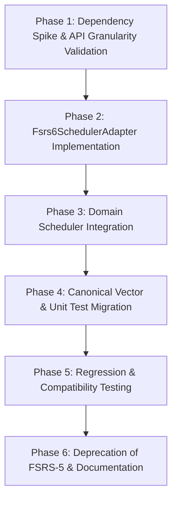

# Technical Migration Plan: FSRS-5 to FSRS-6 (Official Package)

## 1. Context and Motivation

The `flashcards2` scheduling domain is currently powered by a bespoke, pure-Dart implementation of **FSRS-5** (`lib/domain/scheduling/fsrs5.dart`), locked against canonical reference vectors of 19 parameters ($w_0 \dots w_{18}$) with a fixed power-law decay of $-0.5$.

The official pub.dev package [`fsrs`](https://pub.dev/packages/fsrs) (v2.0+) maintains the community-standard **FSRS-6** algorithm, introducing:
1. A trainable forgetting curve decay parameter ($w_{20}$, where $\text{decay} = -w_{20}$).
2. Formalized short-term same-day review saturation ($w_{19}$).
3. A 21-parameter weight vector with updated global defaults.
4. Tighter, more conservative post-lapse interval recovery.

This document details the architectural plan to migrate the scheduling engine to `package:fsrs` while maintaining strict Clean Architecture boundaries, zero runtime data loss, and preservation of domain-specific business rules.

---

## 2. Core Architectural Invariants

### 2.1 Anti-Corruption Layer (ACL / Adapter Pattern)
> [!IMPORTANT]
> **Third-party types must not leak into the domain layer, Drift DAOs, or UI widgets.**
> `package:fsrs` exposes its own models (`Card`, `State`, `Rating`, `ReviewLog`). If these models replace domain entities, the entire persistence, presentation, and session layers become tightly coupled to upstream breaking changes.

* **Design:** Introduce an adapter (`Fsrs6SchedulerAdapter`) inside `lib/domain/scheduling/`.
* **Boundary:** The domain layer continues communicating via `CardSchedule`, `MemoryState`, `Rating`, and `ReviewState`. The adapter handles translation to and from `fsrs.*` types internally.

```
┌────────────────────────────────────────────────────────┐
│                   Domain Layer                         │
│   (CardSchedule, MemoryState, ReviewState, Scheduler)  │
└───────────────────────────┬────────────────────────────┘
                            │ delegates memory math
                            ▼
┌────────────────────────────────────────────────────────┐
│             Fsrs6SchedulerAdapter (ACL)                │
│    Translates Domain Entities <-> package:fsrs Types   │
└───────────────────────────┬────────────────────────────┘
                            │
                            ▼
┌────────────────────────────────────────────────────────┐
│               Third-Party package:fsrs                 │
│                 (v2.0+ Pure Dart)                      │
└────────────────────────────────────────────────────────┘
```

### 2.2 Day-Cutoff & Timezone Preservation (`dayCutoffHour`)
* `package:fsrs` computes card due dates via raw timestamps (`DateTime.now().add(interval)`).
* `flashcards2` enforces calendar-day arithmetic with an explicit rollover hour (`dayCutoffHour = 4`), ensuring reviews performed in the early morning (e.g., 2:00 AM) belong to the preceding scheduling day.
* **Invariant:** The domain `Scheduler` wrapper retains ownership over `dayIndex`, `elapsedDays`, and the final calculation of `due`, using `package:fsrs` strictly to advance continuous memory variables $(S, D)$ and interval durations.

### 2.3 Database Schema & Existing Memory States (Drift)
* The Drift table `schedule_states` stores:
  * `stability` (`REAL`)
  * `difficulty` (`REAL`)
  * `due` (`DateTime`)
  * `reps` (`INT`)
  * `lapses` (`INT`)
  * `state` (`TEXT` / `ReviewState`)
  * `step` (`INT`)
* **No SQL Migration Required:** Both FSRS-5 and FSRS-6 treat Stability ($S$) as the duration in days for retrievability to fall to 90%, and Difficulty ($D$) as a continuous scalar in $[1, 10]$.
* Existing records in `schedule_states` remain valid. On their next review, the FSRS-6 adapter will ingest the stored $(S, D)$ values and compute the subsequent interval under FSRS-6 formulas.

---

## 3. Phased Execution Plan



### Phase 1: Dependency Spike & API Granularity Validation
1. Pin `fsrs` to an exact version in `pubspec.yaml` under `dependencies:` (e.g. `fsrs: 2.0.1`, no caret). The scheduling domain is too central to ride a caret constraint; upgrades become explicit, reviewable operations (see §4).
2. Execute `flutter pub get` and verify dependency resolution.
3. Verify that `package:fsrs` has zero dependencies on `flutter`, `dart:ui`, or native binaries, preserving `lib/domain/` isolation.
4. **API granularity spike (acceptance gate):** the adapter design requires `package:fsrs` to advance continuous memory variables $(S, D)$ and compute an interval *without owning due dates or the learning-step state machine*, both of which stay in the domain `Scheduler`. Before Phase 2 begins, verify in a scratch harness that the package exposes enough granularity to:
   * advance $(S, D)$ for a single review given an explicit `elapsedDays` (not an internally-owned clock),
   * return the scheduled interval (or stability) separately from any due-date calculation,
   * not force its own `Card`/`ReviewLog` session model onto the caller.
   If the package API is session-oriented and cannot be driven at this granularity, STOP: re-evaluate whether to wrap a lower-level entry point, vendor the formula code, or abandon the migration. Do not proceed to Phase 2 on an unproven API assumption.
5. **Determinism check:** verify whether `package:fsrs` applies interval fuzzing/randomization by default and that it can be disabled. The canonical reference-vector tests (Phase 4) are deterministic; a fuzzed scheduler makes them flaky from day one. Record the exact toggle in this document once found.

**Phase 1 outcome (spike executed 2026-10-17, `fsrs` 2.0.1):**

- **Pinned and resolved:** `fsrs: 2.0.1` (exact, no caret), sha256 `b50dbee450a424dbac4fb0f49cae25ff2e4e6d01844caa1ec0c26de5baba8071`. Sole runtime dependency is `meta`; zero Flutter/`dart:ui`/native dependencies — `lib/domain/` isolation preserved.
- **API granularity: GREEN.** The public surface is `reviewCard(card, rating, {reviewDateTime, reviewDuration})` (UTC timestamps mandatory, throws `ArgumentError` otherwise) and `getCardRetrievability`. The caller fully controls the clock: the adapter fabricates `reviewDateTime = lastReview + elapsedDays` to inject explicit day counts. Intervals are extracted as `result.card.due - reviewDateTime`; the package's State/step/due mutations are discarded at the ACL boundary — only `stability` and `difficulty` cross it.
- **Canonical vector: MATCH.** `[G×6, A×2, G×5]` driven through `reviewCard` at due-boundary timestamps yields exactly `[0, 4, 14, 45, 135, 372, 0, 0, 2, 5, 10, 20, 40]`. Phase 4 re-derives it from `fsrs-rs`/`py-fsrs` provenance anyway; this confirms the package reproduces the expected FSRS-6 behavior.
- **Fuzz toggle found:** `Scheduler(enableFuzzing: false)` — fuzzing is **ON by default** (5/5 runs of the same sequence produced distinct long-interval outputs), so every test harness must pass this flag. `Scheduler.customRandom(random, ...)` additionally exists for seeded fuzz. **Open decision for Phase 2:** production policy — keep fuzz ON in production (Anki-compatible load spreading) and OFF in tests, or off everywhere. Record it in Phase 2 before implementing the adapter.
- **Hazard found — same-day `hard` diverges from spec:** on a same-day review the package clamps short-term stability increase to ≥ 1 only for `good`/`easy`; `hard` can *decrease* stability (observed 3.2602 → 1.6644). `py-fsrs`/`fsrs-rs` clamp for every rating except `again`. Phase 2 must decide whether the adapter accepts this divergence or compensates for `hard` before delegating. This directly affects the Option A/B same-day decision below.
- **Minor invariants observed:** same-day detection uses truncated `.inDays` on timestamps (so the adapter's fabricated timestamps must keep reviews exactly on day boundaries), and `_nextInterval` is private (interval extraction via `due` is the only public path, which is why fuzz must be off when extracting).

### Phase 2: Anti-Corruption Layer (`Fsrs6SchedulerAdapter`)
1. Create `lib/domain/scheduling/fsrs6_adapter.dart`:
   * Wrap `fsrs.Scheduler` configured with default 21 parameters.
   * Provide bidirectional mappings for:
     * `domain.Rating` $\longleftrightarrow$ `fsrs.Rating`
     * `domain.ReviewState` $\longleftrightarrow$ `fsrs.State`
     * `domain.MemoryState` $\longleftrightarrow$ `fsrs.Card` fields (`stability`, `difficulty`).
   * Expose methods required by `Scheduler`:
     * `nextMemoryState({required MemoryState? current, required double elapsedDays, required Rating rating})`
     * `nextInterval(double stability)`
2. **Decide same-day governance explicitly.** The domain `Scheduler` owns the learning/relearning step state machine, while FSRS-6 introduces `w19` for same-day review saturation. One — and only one — side may govern stability during same-day reviews:
   * *Option A (preferred):* during `learning`/`relearning`, the domain assigns intervals from its step list and the adapter only advances $(S, D)$ via the package's same-day formula (`w19`); the package never assigns the due date.
   * *Option B:* during steps, the adapter bypasses the package entirely (stability unchanged until graduation), replicating today's behavior with short-term disabled.
   Option A adopts the FSRS-6 semantic the migration exists for, but must be validated against the Phase 4 vectors with `w19` active. Record the chosen option here before implementation; duplicating same-day logic on both sides is the specific failure this decision prevents.
3. **DECISION (2026-10-17): Option A chosen.** During `learning`/`relearning` the domain assigns intervals from its step list and the adapter advances $(S, D)$ only, using the package's same-day formula (`w19`). The package's step/state/due mutations are discarded at the ACL.
4. **DECISION (2026-10-17): package behavior accepted as-is for same-day `hard`.** The adapter does NOT compensate the package's clamp to `good`/`easy` only; a same-day `hard` may decrease stability, exactly as `package:fsrs 2.0.1` implements it. This deviates from `py-fsrs`/`fsrs-rs` (which clamp for every rating except `again`) and from the legacy `Fsrs5Scheduler` (which clamped `hard`). Consequences: (a) tests that exercise same-day `hard` must assert the package's behavior, not the canonical-clamp behavior; (b) if the divergence proves harmful in the field and the package is not fixed upstream, compensation can be added behind the ACL without changing the domain contract.
5. **DECISION (2026-10-17): fuzz ON in production, OFF in tests.** The production adapter runs `Scheduler(enableFuzzing: true)` (the package default) for Anki-compatible due-date spreading; every test harness constructs the adapter's scheduler with `enableFuzzing: false`, which is also required for interval extraction via `due` to be deterministic (Phase 1 step 5).

### Phase 3: Domain `Scheduler` Integration
1. Update `SchedulerConfig` (`lib/domain/scheduling/scheduler.dart`):
   * Replace the hardcoded `Fsrs5Scheduler` instance with `Fsrs6SchedulerAdapter` (or an abstract `MemoryEngine` contract).
2. Maintain the step state machine:
   * `_fromNew`, `_fromLearning`, `_fromReview`, and `_fromRelearning` remain governed by `Scheduler`.
   * Multi-step indices (`step` in `schedule_states`) continue to resume across application restarts.
3. Validate that `AccuracyHeuristic` remains decoupled from the memory math.

### Phase 4: Canonical Vector & Unit Test Migration
1. Replace `test/domain/fsrs5_reference_vectors_test.dart` with `test/domain/fsrs6_reference_vectors_test.dart`.
2. Update the acceptance gate to the canonical FSRS-6 interval vector:
   * **Ratings sequence:** `[G, G, G, G, G, G, A, A, G, G, G, G, G]`
   * **FSRS-5 expected:** `[0, 4, 14, 44, 125, 328, 0, 0, 6, 14, 31, 65, 130]`
   * **FSRS-6 expected:** `[0, 4, 14, 45, 135, 372, 0, 0, 2, 5, 10, 20, 40]`
   * **Provenance (mandatory):** the FSRS-6 vector must be re-derived from the canonical reference implementation — [`open-spaced-repetition/fsrs-rs`](https://github.com/open-spaced-repetition/fsrs-rs) (or `py-fsrs`) — with the default 21 parameters, cited by repository URL and commit hash in the test file header, exactly as the FSRS-5 vector was derived. A vector copied from a blog post or from memory is not an acceptance gate.
   * **Determinism (mandatory):** the fuzz/randomness toggle identified in Phase 1 (step 5) must be disabled in these tests, and the test file must document that dependency explicitly.
3. Update `test/domain/interval_history_test.dart` and confirm all session engine tests (`due_queue_test.dart`, `session_test.dart`, `global_session_test.dart`) pass.

### Phase 5: Regression & Compatibility Verification
1. Implement a test simulating existing cards in the database:
   * Ingest a card with historical FSRS-5 $(S, D)$ values.
   * Apply reviews through the FSRS-6 scheduler and verify that interval updates advance smoothly without clamping anomalies.
2. Verify full UI session flows (`StudySessionLauncher`, `CourseStudyScreen`, `GlobalStudyScreen`).

### Phase 6: Deprecation of FSRS-5 & Documentation
1. **Do not delete `lib/domain/scheduling/fsrs5.dart` immediately.** Freeze it (no further changes) and keep it, along with its reference-vector test, for at least one release after the migration ships. It is the validated rollback path if FSRS-6 behaves badly in the field; stored $(S, D)$ values round-trip between both engines, so rollback is a dependency swap, not a data migration. Delete it only in the following release, once FSRS-6 has real usage evidence.
2. Update references in `docs/design.md` and `docs/technical_explanation.md` documenting the move to FSRS-6 and the rationale for the adapter layer.

---

## 4. Risk Assessment & Mitigations

| Risk | Severity | Mitigation |
| :--- | :--- | :--- |
| **Leakage of `package:fsrs` types into domain or presentation** | High | Enforce Adapter pattern strictly. Lint against importing `package:fsrs` anywhere outside `lib/domain/scheduling/`. |
| **Loss of 4:00 AM day cutoff semantics** | Medium | Compute `due` and `elapsedDays` in `Scheduler` using domain calendar-day functions instead of relying on `package:fsrs` timestamp math. |
| **Post-lapse interval discrepancies** | Low | Expected algorithmic behavior: FSRS-6 is deliberately more conservative on lapses (`2, 5, 10...` vs `6, 14, 31...`) to stabilize damaged memory traces. |
| **`package:fsrs` API not granular enough for the adapter** | High | Phase 1 step 4 is a hard gate: if the package forces a session-oriented model, stop and re-evaluate (lower-level entry point, vendoring, or abandoning the migration) before writing the adapter. |
| **Dependency drift on a domain-critical package** | Medium | Pin an exact version (no caret) in `pubspec.yaml`; upgrades are explicit, reviewed operations validated against the Phase 4 canonical vectors. The ACL contains API churn, but not semantic drift in the algorithm itself. |
| **Upstream abandonment or breaking v3** | Medium | `lib/domain/scheduling/fsrs5.dart` is kept frozen for at least one release after migration (see Phase 6) as a rollback path, and the formula layer is small enough to vendor if the package is ever unmaintained. |
| **Flaky acceptance tests from interval fuzzing** | Medium | Disable package fuzzing via the toggle identified in Phase 1; canonical-vector tests must be fully deterministic. |
